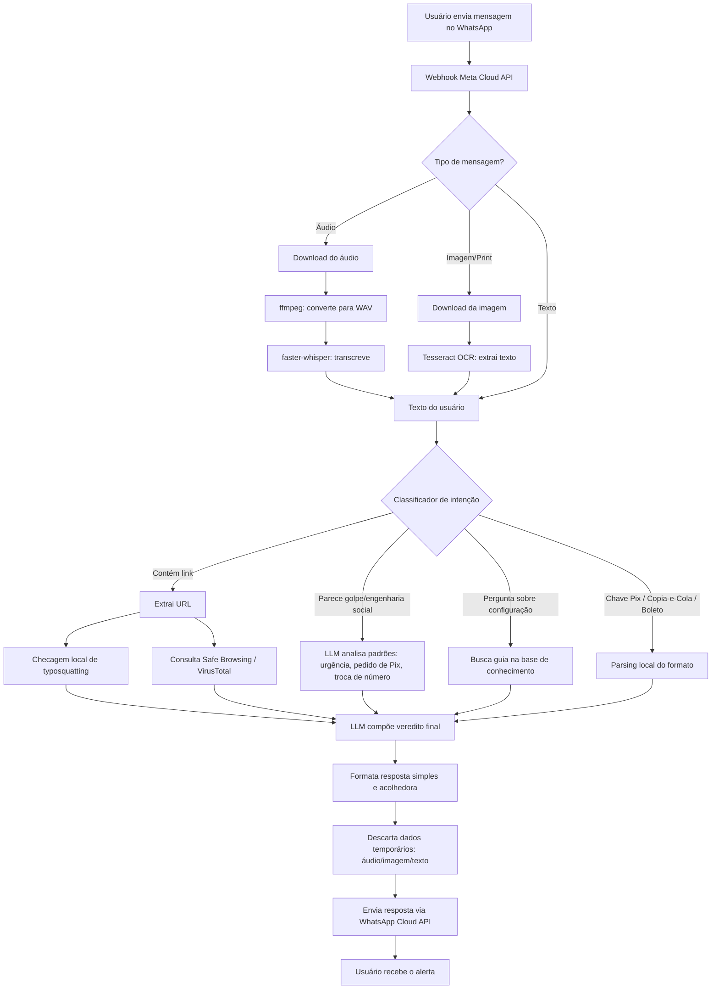

# Plano Técnico — WhatssAppGuard (Mana) — MVP

Complementa [`MVP.md`](./MVP.md). Define as etapas de construção e o fluxo de processamento de mensagens.

---

## 1. Plano de Execução (Sprints)

| Sprint | Entregável | Depende de |
|---|---|---|
| **0 — Infra base** | VM configurada (Nginx, Certbot/TLS, domínio, Security Group), app Meta em modo Development, número de teste ativo | Acesso à VM AWS, domínio |
| **1 — Esqueleto do bot** | Webhook FastAPI recebendo e respondendo mensagem de texto simples (eco) + integração inicial com o LLM (free-tier) | Sprint 0 |
| **2 — Antiphishing de links** | Extração de URL, checagem de typosquatting local, consulta a Safe Browsing/VirusTotal, resposta formatada | Sprint 1 |
| **3 — Engenharia social (prints/texto)** | OCR (Tesseract) + prompt do LLM para detectar padrões de golpe, resposta com % de risco | Sprint 1 |
| **4 — Facilitador de configurações** | Base de guias (2FA, privacidade, bloqueio) + roteamento de intenção via LLM | Sprint 1 |
| **5 — Pix/Boleto** | Parsing local de chave Pix, BR Code (copia-e-cola) e linha digitável de boleto + alerta de formato | Sprint 1 |
| **6 — Comando por voz** | Download de áudio do WhatsApp, conversão (ffmpeg), transcrição (faster-whisper), reuso dos pipelines das sprints 2–5 | Sprints 2, 3, 4, 5 |
| **7 — Privacidade e robustez** | TTL de descarte de mídia/texto, rate limiting (Redis), logging sem dado sensível, tratamento de erro/timeout do webhook | Todas anteriores |
| **8 — Beta fechado** | Testes com usuários reais via números verificados manualmente (até 5, modo Development) | Sprint 7 |

Cada sprint é incremental — nada no MVP depende da Fase 2.

---

## 2. Fluxo de Processamento de Mensagens

### Observações sobre o fluxo

- **Todo caminho converge no LLM** antes de responder — mesmo verificações locais (typosquatting, Pix/boleto) passam por ele para gerar a explicação em linguagem acolhedora, consistente com o tom definido no README.
- **Descarte de dados (passo Q) acontece sempre**, antes do envio da resposta — garante o princípio de Privacy by Design independentemente do caminho percorrido.
- **O classificador de intenção (J)** pode ser o próprio LLM fazendo function-calling/roteamento, em vez de um classificador separado — reduz complexidade no MVP.

---

## 3. Próximo Documento (Fase 2)

Quando o MVP estiver validado, este plano técnico será estendido (ou um novo arquivo criado) para detalhar a Fase 2 — app nativo, IA on-device e módulo de antivírus — conforme já sinalizado em `REQUIREMENTS.md` seção 9.
