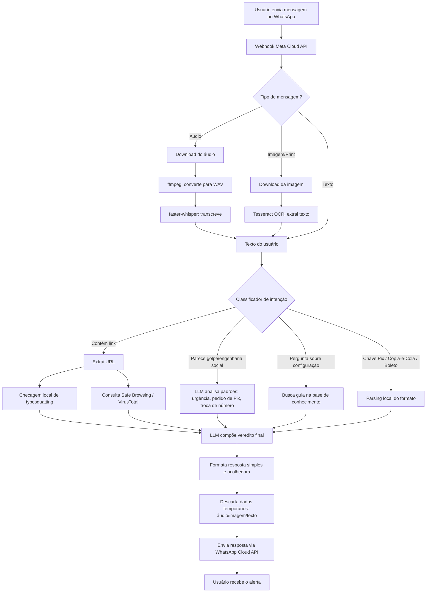

# Plano Técnico — M2SEC Guard — MVP

Complementa [`MVP.md`](./MVP.md). Define as etapas de construção e o fluxo de processamento de mensagens.

---

## 1. Plano de Execução (Sprints)

| Sprint | Entregável | Depende de |
|---|---|---|
| **0 — Infra base** | VM configurada (Nginx, Certbot/TLS, domínio, Security Group), app Meta em modo Development, número de teste ativo. **Ao cadastrar o app no Meta Business Manager, declarar o M2SEC Guard como canal de suporte de segurança do negócio M2SEC já existente — nunca como "assistente de IA" autônomo** (ver `DECISIONS.md` seção 10.1 e `PENDENCIAS.md`) | Acesso à VM AWS, domínio |
| **1 — Esqueleto do bot** ✅ | Webhook FastAPI com disclosure obrigatório ("sou um bot/IA") + menu numerado de intenções fechadas (link, print, Pix/boleto, config, humano) — reformulado em 2026-10-14 por risco de política da Meta contra "chatbot de propósito geral" (ver `DECISIONS.md` seção 10); implementado em `backend/`, testado localmente; falta plugar no número real (depende da Sprint 0) | Sprint 0 |
| **1.5 — Base de conhecimento (RAG)** | Pipeline de embeddings + vector store (Chroma/FAISS) alimentado com os resumos de segurança já escritos (`seguranca.html`, `MARKET_RESEARCH.md`) — só relevante quando migrar para Ollama self-hosted. Ver `REQUIREMENTS.md` seção 3.1 | Sprint 1 |
| **2 — Antiphishing de links** | Extração de URL, checagem de typosquatting local, consulta a Safe Browsing/VirusTotal, resposta formatada | Sprint 1 |
| **3 — Engenharia social (prints/texto)** | OCR (Tesseract) + prompt do LLM (com contexto do RAG, se disponível) para detectar padrões de golpe, resposta com % de risco | Sprint 1 (e 1.5, se já migrado para Ollama) |
| **4 — Facilitador de configurações** | Base de guias (2FA, privacidade, bloqueio) + roteamento de intenção via LLM | Sprint 1 |
| **5 — Pix/Boleto** | Parsing local de chave Pix, BR Code (copia-e-cola) e linha digitável de boleto + alerta de formato. **A resposta nunca deve ecoar o dado completo — sempre mascarar parcialmente** (ver `DECISIONS.md` seção 10.1) | Sprint 1 |
| **6 — Comando por voz** | Download de áudio do WhatsApp, conversão (ffmpeg), transcrição (faster-whisper), reuso dos pipelines das sprints 2–5 | Sprints 2, 3, 4, 5 |
| **7 — Privacidade e robustez** | TTL de descarte de mídia/texto, rate limiting (Redis), logging sem dado sensível, tratamento de erro/timeout do webhook | Todas anteriores |
| **8 — Beta fechado** | Testes com usuários reais via números verificados manualmente (até 5, modo Development) | Sprint 7 |

Cada sprint é incremental — nada no MVP depende da Fase 2.

---

## 2. Fluxo de Processamento de Mensagens

### Observações sobre o fluxo

- **Todo caminho converge no LLM** antes de responder — mesmo verificações locais (typosquatting, Pix/boleto) passam por ele para gerar a explicação em linguagem acolhedora, consistente com o tom definido no README.
- **Descarte de dados (passo Q) acontece sempre**, antes do envio da resposta — garante o princípio de Privacy by Design independentemente do caminho percorrido.
- **O classificador de intenção (J)** pode ser o próprio LLM fazendo function-calling/roteamento, em vez de um classificador separado — reduz complexidade no MVP.

---

## 3. Próximo Documento (Fase 2)

Quando o MVP estiver validado, este plano técnico será estendido (ou um novo arquivo criado) para detalhar a Fase 2 — app nativo, IA on-device e módulo de antivírus — conforme já sinalizado em `REQUIREMENTS.md` seção 9.
