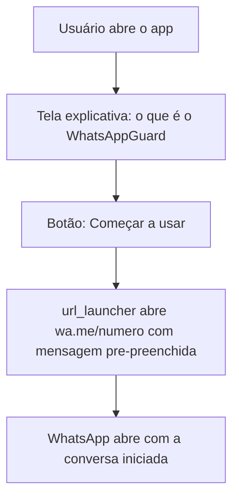
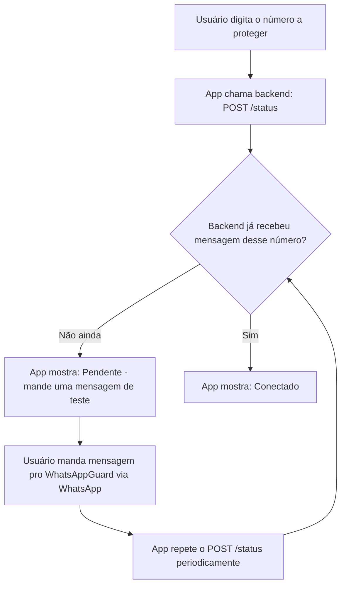
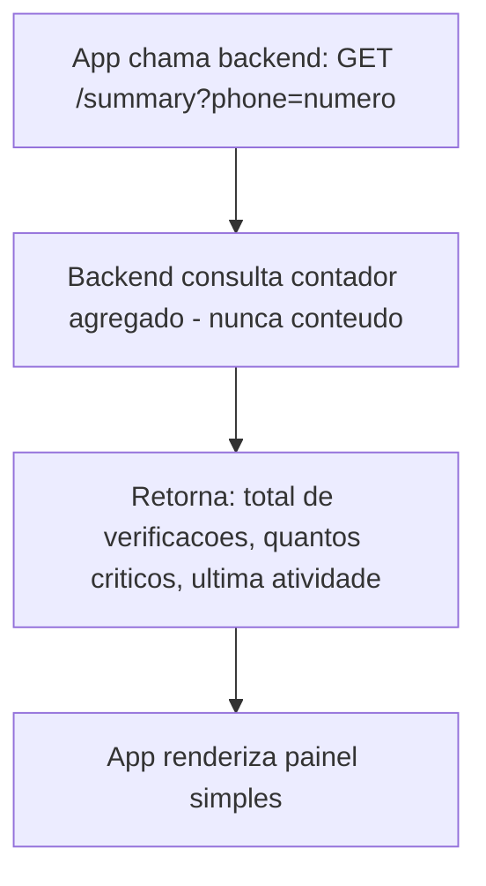
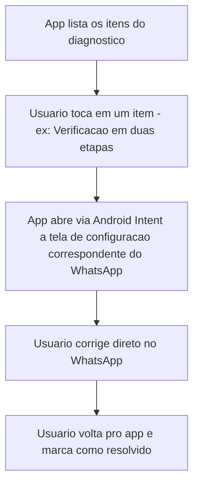
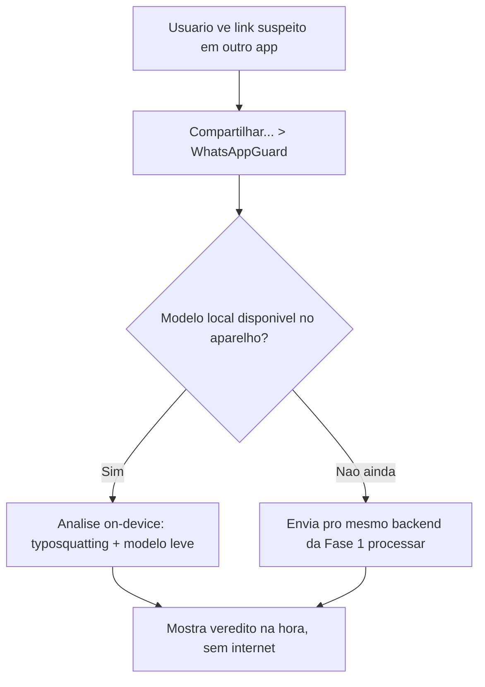
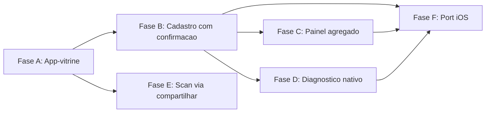

# Plano Técnico — App Mobile WhatsAppGuard

Complementa [`MVP_APP.md`](./MVP_APP.md). Detalha arquitetura, stack e fluxo de cada fase (A a F), na ordem de execução Android → iOS.

> 🎯 **Foco atual: Fases A–E (Android).** A seção 7 (Fase F / iOS) é mantida aqui como referência de planejamento, mas só vira trabalho ativo depois que as fases Android estiverem testadas.

---

## 1. Stack

| Camada | Ferramenta | Por quê |
|---|---|---|
| Framework do app | **Flutter (Dart)** | Único codebase pra Android e iOS — decisão justificada em `MVP_APP.md` seção 2, já que o port pra iOS está confirmado como próximo passo. |
| Gerenciamento de estado | Provider ou Riverpod (Flutter) | Simples o suficiente pras Fases A–D, que são majoritariamente telas + chamadas HTTP. |
| Deep link pro WhatsApp | `url_launcher` (pacote Flutter) abrindo `https://wa.me/<numero>?text=<mensagem>` | Mesmo mecanismo já usado nos botões da landing page — reaproveita o número oficial do WhatsAppGuard. |
| Comunicação com backend | `http` ou `dio` (Flutter) consumindo os endpoints do backend FastAPI já existente (`REQUIREMENTS.md`) | Reaproveita a mesma API que atende o webhook do WhatsApp — só adiciona rotas novas de leitura. |
| Build/CI | Codemagic ou GitHub Actions com Flutter action | Gera o AAB (Android) assinado e sobe automaticamente pro Play Console nas trilhas de teste. |
| Scan local (Fase E, futuro) | TensorFlow Lite / ONNX Runtime Mobile | Mesmo caminho já previsto em `REQUIREMENTS.md` seção 9 para a Fase 2 on-device — a Fase E deste plano É o início dessa Fase 2, só que iniciando pelo "compartilhar link", não pelo antivírus completo. |

---

## 2. Fase A — App-vitrine

- Sem backend, sem login, sem coleta de dado pessoal — só uma vitrine com CTA.
- Entregável: AAB assinado, subido na trilha **Internal Testing** da Play Store.

## 3. Fase B — Cadastro com confirmação

- **Novo endpoint no backend existente:** `GET /status?phone=<numero>` — resposta simples `{"connected": true/false}`, baseada em ter recebido ao menos uma mensagem daquele número (sem expor conteúdo).
- Esse endpoint é o único ponto novo no backend do bot (ver `PLANO_TECNICO.md`) necessário pra essa fase.

## 4. Fase C — Painel/Histórico agregado

- Requer decisão de retenção mínima (contadores agregados apenas) — ver `MVP_APP.md` seção 5, e atualização da política de privacidade antes de implementar.

## 5. Fase D — Diagnóstico nativo

- Os itens e textos são os mesmos já definidos na seção "Diagnóstico" da landing page (`index.html`) — a Fase D só muda o canal de entrega (app nativo em vez de texto no chat).
- Usa Android Intents (`android.intent.action.VIEW` com os esquemas internos do WhatsApp, quando disponíveis) ou, na ausência de deep link oficial pra tela específica, abre o WhatsApp na tela de Configurações geral.

## 6. Fase E — Scan local via "Compartilhar com..."

- Register a `Intent Filter` do Android pra aparecer no menu de compartilhamento do sistema (`ACTION_SEND`, tipo `text/plain`).
- Caminho "sem modelo local ainda" (`E`) é o fallback natural enquanto a Fase 2 on-device completa (ver `REQUIREMENTS.md` seção 9) não está pronta — reaproveita o backend que já existe.

## 7. Fase F — Port para iOS

- Mesmo codebase Flutter; principais pontos de atenção específicos de iOS:
  - `url_launcher` pro WhatsApp funciona igual, mas testar o esquema `whatsapp://` como alternativa ao `https://wa.me/` nesse SO.
  - Compartilhamento (Fase E) no iOS usa **Share Extension**, que é configurada diferente do Android Intent Filter — não é só "compilar pro iOS", precisa de um módulo nativo adicional em Swift para a extensão.
  - Conta de desenvolvedor Apple tem taxa anual (diferente da taxa única do Google Play) e processo de revisão mais rígido — considerar isso no planejamento de tempo, não só de código.

---

## 8. Resumo de dependências entre fases

Cada fase é um app entregável e testável por si só — nenhuma fase depende de uma fase futura, só das anteriores.
