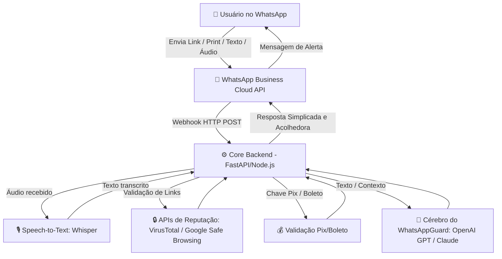

# 🛡️ WhatsAppGuard - Seu Anjo da Guarda Digital no WhatsApp

O **WhatsAppGuard** é um assistente virtual baseado em Inteligência Artificial especializado em cibersegurança e proteção ativa para **usuários leigos**. Operando diretamente de forma nativa dentro do WhatsApp, o WhatsAppGuard traduz conceitos complexos de segurança digital em ações simples, protegendo o usuário contra golpes financeiros, engenharia social e links maliciosos.

---

## 🚀 Proposta de Valor e Funcionalidades

O projeto resolve o elo mais vulnerável da segurança digital: o fator humano. O usuário leigo não sabe configurar firewalls ou ler cabeçalhos de e-mail, mas sabe conversar no WhatsApp.

### 🔴 1. Análise Reativa de Links (Antiphishing)
O usuário encaminha qualquer link suspeito (ex: falsas promoções, alertas de bancos falsos) para o WhatsAppGuard.
*   **Como funciona:** A aplicação analisa o domínio contra ataques de *Typosquatting* (ex: `banc0.com`) e faz varreduras em APIs de reputação de URL (como VirusTotal ou Google Safe Browsing).
*   **Retorno ao usuário:** Um aviso simples, visual e direto: `⚠️ ESSE LINK É PERIGOSO` ou `✅ Seguro para acessar`.

### 🧠 2. Detecção de Engenharia Social (Falso Parente & Urgência)
Análise de capturas de tela (prints) ou mensagens encaminhadas de números desconhecidos exigindo dinheiro ou favores urgentes.
*   **Como funciona:** O cérebro do WhatsAppGuard (LLM) é treinado com gatilhos de golpes comuns (Urgência extrema, mudança repentina de número, chantagem ou pedidos de Pix/transferência).
*   **Retorno ao usuário:** Alertas preventivos como: *"Atenção! Esta conversa tem fortes indícios de fraude (90% de chance). Ligue para a pessoa por fora do WhatsApp antes de enviar qualquer valor."*

### ⚙️ 3. Facilitador de Configurações e Diagnóstico de Segurança (Linguagem Natural)
Usuários leigos têm dificuldade em navegar nos menus do WhatsApp. O WhatsAppGuard age como uma ponte — e não só responde pergunta pontual, também faz um diagnóstico completo da conta quando solicitado.
*   **Exemplo (pergunta pontual):** O usuário digita *"WhatsAppGuard, como coloco senha no meu Zap?"*.
*   **Exemplo (diagnóstico completo):** O usuário digita *"WhatsAppGuard, minha conta está segura?"* e recebe uma checagem priorizada (verificação em duas etapas, visibilidade de foto/"visto por último", dispositivos conectados desconhecidos, backup de conversas) com o passo a passo exato de correção para cada item encontrado.
*   **Retorno ao usuário:** Guia interativo visual simplificado (passo a passo) para ativar a Verificação em Duas Etapas, ajustar privacidade ou remover um dispositivo conectado suspeito — sempre com links diretos de redirecionamento, se aplicável.

### 🎙️ 4. Verificação de PIX e Boleto (por Texto ou Comando de Voz)
Golpes de chave Pix falsa, "Pix Copia e Cola" fraudulento e boletos adulterados são um dos vetores de fraude financeira mais comuns no Brasil. O WhatsAppGuard também aceita verificação **por áudio**, para que o usuário leigo não precise nem digitar.
*   **Como funciona:** O usuário manda um áudio (*"WhatsAppGuard, pode verificar essa chave Pix pra mim?"*) ou cola o código/boleto em texto. O WhatsAppGuard transcreve o áudio (Speech-to-Text), identifica o dado (chave Pix, código Copia e Cola, linha digitável de boleto) e cruza contra padrões de fraude conhecidos e formato esperado.
*   **Retorno ao usuário:** Alerta de risco simples, igual aos demais recursos: `⚠️ Esse Pix tem sinais de fraude` ou `✅ Formato válido, mas sempre confirme o destinatário antes de pagar`.

---

## 🧭 Roadmap — Fase 2 (Módulo On-Device)

Os recursos acima (1 a 4) rodam via API/nuvem (o conteúdo é enviado para processamento e descartado — ver seção de Privacidade). Em uma segunda fase, planejamos um **módulo complementar nativo no aparelho (app companion)**, para os casos em que processar 100% localmente é importante:

*   **Processamento 100% On-Device:** um modelo de IA leve rodando direto no celular do usuário (sem enviar o conteúdo para nenhum servidor), inspirado no recurso "Scam Alert" que a própria Meta está testando no WhatsApp. Isso exige um app próprio instalado (não é possível fazer isso só pelo chat do WhatsApp).
*   **Antivírus e Segurança do Dispositivo:** varredura de apps instalados, bloqueio de links maliciosos no nível do sistema, proteção contra roubo/perda do aparelho — função equivalente à do dfndr/PSafe, mas integrada à mesma identidade do WhatsAppGuard.

> Este módulo depende de um app mobile nativo (Android/iOS) e é tratado como **Fase 2** do projeto — não faz parte do MVP via WhatsApp.

---

## 🛠️ Arquitetura de Alto Nível Sugerida

> **Fase 2 (futuro, fora deste diagrama):** app companion nativo rodando um modelo local no aparelho, para processamento 100% on-device e funções de antivírus/segurança de dispositivo (ver Roadmap acima).

---

## 🔒 Compromisso com a Privacidade (LGPD)

Como o WhatsAppGuard analisa mensagens enviadas por usuários, o projeto adota o princípio de **Privacy by Design**:
*   Nenhum histórico de conversa pessoal identificável é armazenado permanentemente no banco de dados.
*   Os dados textuais ou imagens enviados são processados efemeramente apenas para gerar o veredito de risco de segurança e imediatamente descartados.

---

## ⚙️ Tecnologias Envolvidas (Roadmap Tecnológico)

*   **Runtime:** Node.js (Express/NestJS) OU Python (FastAPI).
*   **Interface WhatsApp:** API Oficial da Meta (WhatsApp Cloud API) ou Provedores de Gateway (Evolution API, Twilio).
*   **Cérebro de IA:** OpenAI API (GPT-4o-mini para baixo custo e latência) com engenharia de prompt avançada.
*   **Voz:** Whisper (Speech-to-Text) para transcrever áudios enviados pelo usuário.
*   **Segurança e Infra:** APIs de Threat Intelligence.
*   **Fase 2 (roadmap):** app mobile nativo para módulo on-device + antivírus (ver Roadmap).

Veja o detalhamento completo de requisitos técnicos em [`REQUIREMENTS.md`](./REQUIREMENTS.md), a pesquisa de mercado em [`MARKET_RESEARCH.md`](./MARKET_RESEARCH.md), o posicionamento competitivo em [`MARKETING_PLAN.md`](./MARKETING_PLAN.md), o escopo do MVP em [`MVP.md`](./MVP.md) e o plano técnico/fluxo de processamento em [`PLANO_TECNICO.md`](./PLANO_TECNICO.md).
