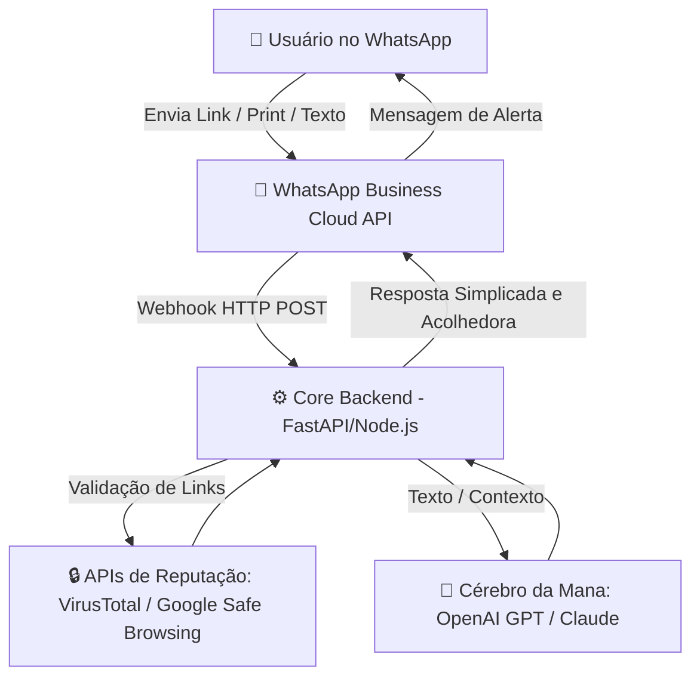

# 🛡️ WhathsappGuard - Seu Anjo da Guarda Digital no WhatsApp

A **Mana** é uma assistente virtual baseada em Inteligência Artificial especializada em cibersegurança e proteção ativa para **usuários leigos**. Operando diretamente de forma nativa dentro do WhatsApp, a Mana traduz conceitos complexos de segurança digital em ações simples, protegendo o usuário contra golpes financeiros, engenharia social e links maliciosos.

---

## 🚀 Proposta de Valor e Funcionalidades

O projeto resolve o elo mais vulnerável da segurança digital: o fator humano. O usuário leigo não sabe configurar firewalls ou ler cabeçalhos de e-mail, mas sabe conversar no WhatsApp.

### 🔴 1. Análise Reativa de Links (Antiphishing)
O usuário encaminha qualquer link suspeito (ex: falsas promoções, alertas de bancos falsos) para a Mana.
*   **Como funciona:** A aplicação analisa o domínio contra ataques de *Typosquatting* (ex: `banc0.com`) e faz varreduras em APIs de reputação de URL (como VirusTotal ou Google Safe Browsing).
*   **Retorno ao usuário:** Um aviso simples, visual e direto: `⚠️ ESSE LINK É PERIGOSO` ou `✅ Seguro para acessar`.

### 🧠 2. Detecção de Engenharia Social (Falso Parente & Urgência)
Análise de capturas de tela (prints) ou mensagens encaminhadas de números desconhecidos exigindo dinheiro ou favores urgentes.
*   **Como funciona:** O cérebro da Mana (LLM) é treinado com gatilhos de golpes comuns (Urgência extrema, mudança repentina de número, chantagem ou pedidos de Pix/transferência).
*   **Retorno ao usuário:** Alertas preventivos como: *"Atenção! Esta conversa tem fortes indícios de fraude (90% de chance). Ligue para a pessoa por fora do WhatsApp antes de enviar qualquer valor."*

### ⚙️ 3. Facilitador de Configurações (Linguagem Natural)
Usuários leigos têm dificuldade em navegar nos menus do WhatsApp. A Mana age como uma ponte.
*   **Exemplo:** O usuário digita *"Mana, como coloco senha no meu Zap?"*.
*   **Retorno ao usuário:** A Mana retorna um guia interativo visual simplificado (passo a passo) para ativar a Verificação em Duas Etapas ou links diretos de redirecionamento, se aplicável.

---

## 🛠️ Arquitetura de Alto Nível Sugerida

---

## 🔒 Compromisso com a Privacidade (LGPD)

Como a Mana analisa mensagens enviadas por usuários, o projeto adota o princípio de **Privacy by Design**:
*   Nenhum histórico de conversa pessoal identificável é armazenado permanentemente no banco de dados.
*   Os dados textuais ou imagens enviados são processados efemeramente apenas para gerar o veredito de risco de segurança e imediatamente descartados.

---

## ⚙️ Tecnologias Envolvidas (Roadmap Tecnológico)

*   **Runtime:** Node.js (Express/NestJS) OU Python (FastAPI).
*   **Interface WhatsApp:** API Oficial da Meta (WhatsApp Cloud API) ou Provedores de Gateway (Evolution API, Twilio).
*   **Cérebro de IA:** OpenAI API (GPT-4o-mini para baixo custo e latência) com engenharia de prompt avançada.
*   **Segurança e Infra:** APIs de Threat Intelligence.
